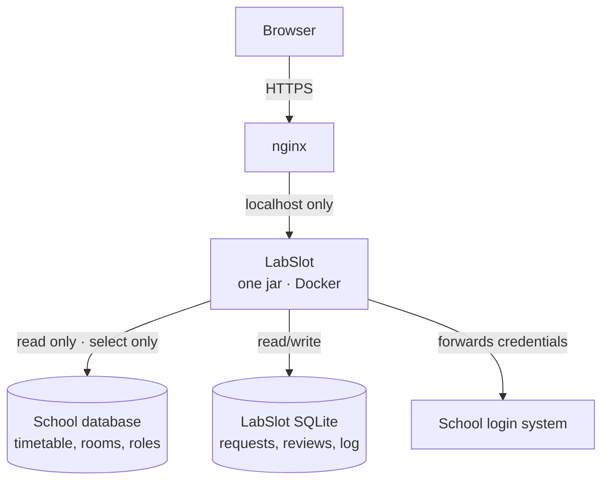

## Context and constraints

To book a computer lab you first need to know whether a period has a class and whether someone already took it, and the timetable lives in the school's management system. LabSlot's job is to put both on one screen, so a teacher can pick a few cells and send a request.

The constraints shaped the design more than the features did:

- **The school's existing systems are off limits.** They run the school; however badly this project fails, it must not touch them.
- **It should need as little looking after as possible.** You can't assume someone is watching the server. Deploying, backing up and restoring have to be simple enough for whoever takes over to do from the docs.
- **Most users are not comfortable with computers.** Big buttons, clear text, a clear result after every step, no dragging, no shortcuts to remember.

## Architecture

The data is split in two. School data (timetables, rooms, period times, account roles) is always read from the school database **read-only**: the app issues only selects, takes only the columns it needs, never writes, and caches results for 15 minutes. What LabSlot creates itself (requests, reviews, closures, the audit log) lives in its own SQLite file. Credentials are forwarded to the school's own login system; LabSlot never stores or logs a school password.

The backend is Java 17 + Spring Boot, the frontend React + TypeScript, built into the same jar. The server runs a single file, so deploying or rolling back is swapping that file.

## Key trade-offs

<Decision chose="Its own SQLite, one file" over="A separate database server" lang="en">

One less service to look after is one less thing to go wrong. SQLite runs in WAL mode with a daily `VACUUM INTO` backup, 30 kept; the restore was rehearsed for real before launch. For the booking volume of a few labs, one file is plenty.

</Decision>

<Decision chose="A partial unique index stops double booking" over="Check whether it is taken, then write" lang="en">

Check-then-write lets two simultaneous requests both succeed. A unique index on `(room, date, period) where active = 1` allows only one active request per period, so in a race exactly one wins; rejecting or cancelling sets `active = 0` and frees the period.

</Decision>

<Decision chose="Forward to the school login; LabSlot never holds passwords" over="Build its own accounts and passwords" lang="en">

Own accounts would mean creating accounts, resetting passwords and disabling leavers for every staff member, another password for teachers to remember, and a system full of passwords to protect. Forwarding means a password passes through one request and is never stored or logged. Any response from the school system that is not recognised counts as a failure, so a redesign on their side can never let someone in by mistake.

</Decision>

<Decision chose="Local admins wrap the school login" over="Two logins side by side, falling through on failure" lang="en">

Administrator accounts live in LabSlot's own database (bcrypt hashes only). Side by side, an administrator's typo would "fail and try the next one" and send the admin password to the school system. So local accounts are checked first, and a local account is verified locally only, never forwarded.

</Decision>

<Decision chose="Refuse to start in production with dangerous settings" over="A note in the docs for whoever deploys" lang="en">

Nobody rereads the docs on every deploy. An insecure cookie, connecting to the school database with an over-privileged account, letting students log in, or demo data switched on each stop the app from starting, and those checks have tests of their own.

</Decision>

<Decision chose="Tests focused on booking rules and security" over="Chasing coverage on every layer" lang="en">

Automated tests guard the two most expensive places: booking rules (no double booking, no booking over a class) and security (login, permissions, failing closed, rate limits). They run on a real SQLite, a fake school and an adjustable clock; the UI and exports are checked by hand. Every deploy runs the tests first; if they fail the image is not swapped and the old version keeps running.

</Decision>

## After launch

Going live taught more than writing the code.

**Accounts don't look the way you expect.** Staff habitually sign in to the school system with an alias, but in LabSlot only one way of writing the account worked: the old version compared what the teacher typed with the account the school reported, and any mismatch was a failure. The fix uses the account the school login system itself reports to check the role, instead of comparing the typed text; it is being verified on campus with real accounts.

**Personal data gets in from unexpected places.** The login account is written into requests, the audit log and exports. If the account itself carries personal data (an ID number, say), it is stored all the way down, and the audit log is append-only. The next step is to refuse logins in that format before they are sent for verification, and to tell the user to use their regular school account instead of answering "wrong account or password" until they are locked out. It ships only once alias login is confirmed to work, or it would lock everyone out.

**The server's CPU crashed the build.** The frontend toolchain's native binaries need AVX, and the server's default CPU settings didn't expose it, so the build died with `Illegal instruction`. Changing the CPU settings fixed it, and that is in the deployment docs now.

## What I learned

- **Constraints decide the architecture more than features do.** "Don't touch the school's systems" and "it should need as little looking after as possible" settled almost every technical choice.
- **Know the shortcut, and know why you don't take it.** There was more than one faster way to build this, but some would have the system touch data it shouldn't, or make it harder for the next maintainer.
- **Ship at seventy percent, then improve from real use.** Account formats, personal data, hardware limits: none of them show up on a development machine.
