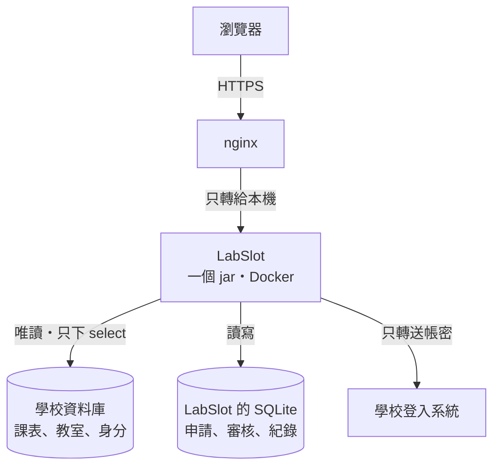

## 背景與限制

要借電腦教室，得先知道那一節有沒有課、有沒有人借走，而課表在學校的校務系統裡。LabSlot 的工作，就是把這兩件事放在同一個畫面，讓老師點幾格就送出申請。

真正決定設計的是限制，不是功能：

- **學校原本的系統不能碰。** 校務系統是學校的命脈，這個專案再怎麼出錯，都不能影響它。
- **要盡量不需要人顧。** 不能假設隨時有人盯著這台伺服器。部署、備份、還原都要簡單到接手的人照著文件就能做。
- **使用者大多不熟電腦。** 按鈕要大、字要清楚、每一步都有明確的結果，不靠拖曳、不靠記快捷鍵。

## 架構

資料切成兩邊。學校的資料（課表、教室、節次時間、帳號身分）一律從學校的資料庫**唯讀**取得：程式只下 select、只取需要的欄位，從不寫入，結果快取 15 分鐘；LabSlot 自己產生的資料（申請、審核、暫停開放、稽核紀錄）存在自己的 SQLite 檔案。帳號密碼轉送給學校原本的登入系統驗證，LabSlot 不存、也不記任何學校密碼。

後端是 Java 17 + Spring Boot，前端是 React + TypeScript，建置後打包進同一個 jar。伺服器上只有一個檔案在跑，部署和回滾就是換掉這個檔案。

## 關鍵取捨

<Decision chose="自己的 SQLite，一個檔案" over="另外架一台資料庫伺服器">

能少顧一個服務，就少一個出事的地方。SQLite 開 WAL 模式，每天用 `VACUUM INTO` 備份，保留 30 份；還原流程在上線前實際演練過一次。以幾間電腦教室的借用量，單一檔案綽綽有餘。

</Decision>

<Decision chose="資料庫的部分唯一索引擋重複借用" over="程式裡先查有沒有人借、再寫入">

「先查再寫」在兩個人同時送出時會兩筆都成功。改成在資料庫加上 `(教室, 日期, 節次) where active = 1` 的唯一索引，同一節只會有一筆有效申請，搶的時候只有一個人成功；駁回或取消就把 `active` 設成 0，節次自動放出來。

</Decision>

<Decision chose="轉送學校登入系統驗證，LabSlot 不碰密碼" over="自己建一套帳號密碼">

自己做帳號，就要處理全校教職員的開帳號、忘記密碼、離職停用，老師還得多記一組密碼，LabSlot 也會變成保管大量密碼的地方。轉送驗證則讓密碼只經過一次請求，不落地、不寫 log。學校系統的回應只要認不出來，一律當作失敗，不會因為學校改版就誤放人進來。

</Decision>

<Decision chose="本地管理員包在學校登入的外層" over="兩種登入並排，失敗就換下一種">

管理員帳號存在 LabSlot 自己的資料庫（只存 bcrypt 雜湊）。如果兩種登入並排，管理員打錯密碼時會「失敗就試下一個」，把管理員密碼送到學校的系統去。所以本地帳號先攔下來比對，是本地帳號就只在本機驗證，絕不外送。

</Decision>

<Decision chose="正式環境啟動時檢查危險設定，有問題就拒絕啟動" over="寫在文件裡，提醒部署的人注意">

沒有人會每次部署都重讀文件。cookie 沒設 secure、用權限過大的帳號連學校資料庫、允許學生登入、開著示範資料，任何一項都直接讓程式起不來，連同這些檢查本身都有測試。

</Decision>

<Decision chose="測試集中在借用規則和安全" over="每一層都追求覆蓋率">

自動測試只守兩個最貴的地方：借用規則（會不會借重、會不會借到有課的節次）和安全（登入、權限、拒絕放行、限流）。測試跑在真的 SQLite、假的學校資料和可以調整的時鐘上；介面和匯出則實際操作確認。每次部署都要先跑完測試，失敗就不換版，舊版繼續跑。

</Decision>

## 上線之後

上線才知道的事，比寫程式時多。

**帳號長得不一樣。** 老師在學校系統習慣用英文別名登入，到了 LabSlot 卻只有一種寫法進得去：舊版拿「老師打的字」去比對學校回報的帳號，兩邊不一致就判定失敗。修正的做法是改用學校登入系統自己回報的帳號去確認身分，不再拿輸入的字比對；這版正在校內用真實帳號驗證。

**個資會從意想不到的地方進來。** 登入用的帳號會跟著寫進申請、稽核紀錄和匯出檔。如果帳號本身帶著個資（例如證件號碼），它就會一路被存下去，而稽核紀錄是只能新增、不能刪的。接下來的處理是在送出驗證之前就擋下這類格式的輸入，並直接告訴使用者改用一般的學校帳號，而不是丟一句「帳號或密碼錯誤」讓人一直重試到被鎖。這一步要等別名登入確認可用才上線，不然會把所有人擋在外面。

**伺服器的 CPU 會讓建置當掉。** 前端工具鏈的原生程式需要 AVX 指令集，伺服器預設的 CPU 設定沒有開，建置直接 `Illegal instruction`。調整 CPU 設定才解決，這件事也寫進了部署文件。

## 學到的事

- **限制比功能更能決定架構。** 「學校的系統不能碰」「要盡量不需要人顧」這兩句話，幾乎決定了每一個技術選擇。
- **知道有捷徑，也要知道為什麼不走。** 技術上能更快完成的做法不只一種，但會讓系統碰到不該碰的資料，或讓之後的維護者接手更難。
- **先以七成上線，再用真實的使用回頭改。** 帳號格式、個資、硬體限制，沒有一個是在開發機上測得出來的。
