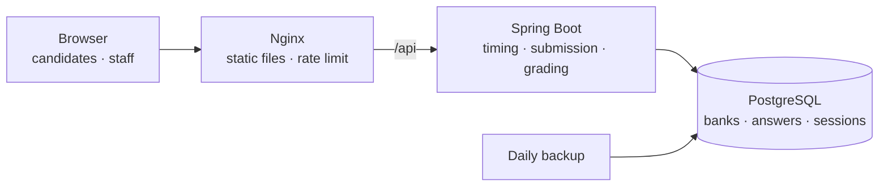

## Context and constraints

A school's admission exam is moving from paper to computer labs: a few hundred candidates at once, one exam officer running the exam, a few teachers writing and grading. Testa covers the whole path, from writing questions and scheduling to proctoring, grading and publishing results.

What sets an exam system apart from an ordinary website is the cost of getting it wrong:

- **The exam has to be fair.** A candidate's computer must not be able to change the time, the paper must not carry the answers, and graders must not know whose paper they are grading.
- **The lab may be cut off from the Internet.** Nothing can depend on an outside service; even fonts and math rendering are bundled.
- **There is no time to investigate during an exam.** If the backend or database restarts mid-exam, no one may be signed out and no answer may be lost, and whoever runs the server has to be able to handle it from the docs.

## Architecture

Everything runs with Docker Compose on one VM inside the school. The frontend is Vue 3 + TypeScript, the backend Java 21 + Spring Boot, data lives in PostgreSQL, and the schema is managed by Flyway, add-only, never editing a shipped version. Sessions live in the database too, so restarting the backend signs no one out.

## Key trade-offs

<Decision chose="Timing, submission and grading only on the server" over="A browser countdown that submits when time is up" lang="en">

A browser's clock can be changed and a computer can crash. So the deadline exists only on the backend: a candidate who reconnects gets the remaining time from the server, candidates who never come back are submitted by the backend, and extra time only moves the server-side deadline. The countdown in the browser is display only. Papers sent to candidates use a separate data shape with no fields for answers, explanations or rubrics, and a test enforces it.

</Decision>

<Decision chose="One VM, with resilience from restarts, extra time and rehearsed restores" over="A distributed deployment with hosts backing each other up" lang="en">

A few hundred candidates fit easily on one machine; several machines would bring more syncing and operations problems than they solve. The effort went into what happens when things break instead: restarting the backend and database mid-exam is tested and candidates resume where they left off, and the daily backup has been restored into an emptied database for real.

</Decision>

<Decision chose="Candidate number plus a login code, printed as a slip" over="An account for every candidate, or the school's own sign-in" lang="en">

Candidates are not students yet and have no school account, and asking them to register adds one more step that can go wrong. The exam officer imports the roster (Excel or CSV, Big5 included), the system generates login codes, and slips are printed and placed on the desks. A candidate can have only one active session, too many wrong codes lock the candidate out, and a proctor can reset it.

</Decision>

<Decision chose="Administrators cannot see papers without the exam owner's time-limited grant" over="Administrators can see everything" lang="en">

Administrators look after accounts and the system, not exam content. When someone really needs to step in (the school asked for emergency access with authorisation and a record), the exam's owner grants one administrator time-limited, read-only access, and every view goes into the append-only audit log. Every permission check goes through one guard instead of being scattered around the code.

</Decision>

<Decision chose="One or more anonymous graders, averaged, with a warning on large disagreements" over="Exactly three graders" lang="en">

The first requirement was exactly three; the school later changed it to one or more, so the number is not hard-coded. Graders see only a paper code, never the candidate's name or other graders' scores. When graders differ by more than 20% of a question's points, the officer is warned before publishing. A submitted score can't be changed by the grader; the officer reopens it with a reason.

</Decision>

<Decision chose="Candidate score access decided per exam, off by default" over="Candidates can always sign in to see published scores" lang="en">

Essays need teacher review, and the school announces results on its own website. So publishing means locking scores and exporting them to Excel for the school. Whether candidates can sign in to see their total and subtotals is the officer's choice for each exam, and they only ever see scores, never answers or comments.

</Decision>

## Before launch

It has not launched at the school yet. Everything that can be checked in development has been checked on the production images:

**300 candidates at once.** 300 candidates signing in, answering and submitting at the same time with no failures; p99 through Nginx is 12 ms.

**A full exam with no Internet.** On a network with no Internet access, start-up, first-run setup and a whole exam all work, and the browser makes no external requests.

**An automated end-to-end exam.** One script runs a whole exam, from first-run setup, authoring and roster import to answering, grading, publishing and archiving; backend integration tests run against real PostgreSQL in CI on every push.

Next is deploying on the school's VM and running a mock exam in a real lab with the Internet actually cut off: internal DNS and routing from every lab, browsers on Windows, and login slips printed on the school's printers can only be tested on site.

## What I learned

- **Put each rule in one place and let tests guard it.** Timing only on the backend, one permission guard, no answers in papers: these hold because they live in one place under test, not because someone remembers them every time.
- **Requirements change, so ask what might change.** The number of graders went from three to one or more, and score access became a per-exam choice; making the likely changes settings kept each change small.
- **Test everything development can test first, so the site trial is only about the site.** Load, offline, restarts and restores were all checked in development, leaving the lab rehearsal free to focus on the network and the hardware.
