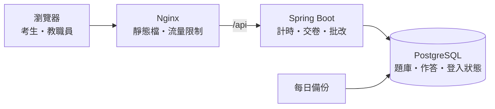

## 背景與限制

學校的招生考試要從紙本搬到電腦教室：幾百位考生同時作答，一位承辦人管整場考試，幾位老師出題和閱卷。Testa 要把出題、排考、監考、閱卷到公布成績做成一條完整的流程。

考試系統和一般網站不一樣的地方，在於出錯的代價：

- **考試要公平。** 時間不能被考生的電腦改掉，考生拿到的試卷裡不能藏著答案，閱卷老師不能知道自己在改誰的卷子。
- **考場可能斷網。** 考試當天電腦教室可能切斷外網，系統不能依賴任何外部服務，連字型和數學式都要打包在裡面。
- **出事時沒有時間查。** 考到一半後端或資料庫重開，考生不能因此被登出、作答不能不見；負責維運的人照著文件就要能處理。

## 架構

整套用 Docker Compose 跑在校內的一台 VM 上。前端是 Vue 3 + TypeScript，後端是 Java 21 + Spring Boot，資料存在 PostgreSQL，資料庫結構由 Flyway 管理，只新增、不改已上線的版本。登入狀態也存在資料庫裡，所以重開後端不會把任何人登出。

## 關鍵取捨

<Decision chose="計時、交卷、批改只在伺服器做" over="在瀏覽器倒數，時間到由前端送出">

前端的時間可以被改、電腦可以當機。所以截止時間只存在後端：考生斷線重連時從伺服器拿剩下的時間，沒回來的考生由後端自動交卷，補時也只改後端的截止時間。瀏覽器上的倒數只是顯示。送給考生的試卷另外用一組資料結構，裡面沒有答案、解析和評分規準的欄位，並有測試把關。

</Decision>

<Decision chose="一台 VM，可靠性來自重啟、補時和演練過的還原" over="分散式部署，多台主機互相備援">

考試規模是幾百人，一台主機綽綽有餘；多台主機帶來的同步和維運問題，反而比它解決的多。所以把力氣花在「壞了怎麼辦」：考到一半重開後端和資料庫都測過，考生回來能接續作答；每天備份，並實際把備份還原到清空的資料庫。

</Decision>

<Decision chose="准考證號加一組登入碼，印成登入單" over="替每位考生建帳號，或接學校的登入系統">

考生還不是學生，沒有學校帳號；讓他們註冊又多一個會出錯的步驟。承辦人匯入名單（Excel 或 CSV，連 Big5 編碼都吃）後，系統產生登入碼、直接印成登入單發到座位上。同一位考生同時只能有一個連線，登入碼輸錯太多次會鎖定，監考可以重設。

</Decision>

<Decision chose="系統管理員看不到考卷，要考試負責人授權才能限時檢視" over="管理員什麼都看得到">

管理員管的是帳號和系統，不是考試內容。真的需要介入時（學校要求緊急檢視要有授權和紀錄），由該場考試的負責人授權一位管理員、有時間限制、唯讀，每一次檢視都寫進只能新增的操作紀錄。所有權限檢查只走同一個關口，不散在各處。

</Decision>

<Decision chose="一到多位老師匿名閱卷，分數取平均，差距過大時提醒" over="固定三位評分者">

最初的需求是剛好三位，後來學校改成一到多位，所以人數不寫死。閱卷老師只看得到答卷代號，看不到考生姓名和其他人的分數；老師之間的差距超過配分的 20% 時，公布前提醒承辦人。送出後不能自己改，要承辦人重開並寫原因。

</Decision>

<Decision chose="考生能不能查成績，由每場考試決定，預設關閉" over="公布後一律開放考生登入查詢">

申論題要老師審核，學校也會在官網放榜。所以公布成績的意思是鎖定分數、匯出 Excel 交給學校；要不要讓考生自己登入看總分和小計，由承辦人每場決定，而且只給分數，不給答案和評語。

</Decision>

## 上線前的驗證

還沒在學校上線。開發機上能驗的，都在正式環境的映像檔上驗過了：

**300 人同時作答。** 300 位考生同時登入、作答、交卷，沒有失敗，經過 Nginx 的 p99 是 12 ms。

**斷網考完一整場。** 在沒有網際網路的網路裡從啟動、第一次設定到整場考試都能跑完，瀏覽器沒有發出任何對外請求。

**整場考試的自動測試。** 一支腳本從第一次設定、出題、匯入名單、作答、閱卷、公布到封存跑完一整場；後端整合測試跑在真的 PostgreSQL 上，每次 push 都由 CI 執行。

接下來是在學校的 VM 上部署，用真的電腦教室、真的斷網辦一場模擬考：校內 DNS 和各教室的路由、Windows 上的瀏覽器、學校印表機印出來的登入單，這些只有在現場才測得到。

## 學到的事

- **規則要寫在一個地方，並讓測試守住。** 計時只在後端、權限只走一個關口、試卷不含答案，這些都靠集中一處和測試，而不是靠每次寫程式時記得。
- **需求會變，所以先問「會不會變」。** 評分人數從三位變成一到多位、考生查成績改成每場自己決定，把可能變的東西做成設定，改起來就很小。
- **開發機能測的先測完，剩下的才是現場的事。** 負載、斷網、重啟、還原都先在開發機上驗過，現場演練才能專心在網路和設備上。
